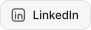
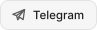
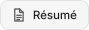

<picture>
  <source media="(prefers-color-scheme: dark)" srcset="assets/hero-dark.svg">
  <source media="(prefers-color-scheme: light)" srcset="assets/hero-light.svg">
  
</picture>

  <a href="https://neupanekamal.com.np"><picture><source media="(prefers-color-scheme: dark)" srcset="assets/link-site-dark.svg"></picture></a>&nbsp;
  <a href="https://www.linkedin.com/in/neupanekamal"><picture><source media="(prefers-color-scheme: dark)" srcset="assets/link-linkedin-dark.svg"></picture></a>&nbsp;
  <a href="https://t.me/kamalneupane"><picture><source media="(prefers-color-scheme: dark)" srcset="assets/link-telegram-dark.svg"></picture></a>&nbsp;
  <a href="https://bit.ly/kamal-resume"><picture><source media="(prefers-color-scheme: dark)" srcset="assets/link-resume-dark.svg"></picture></a>

